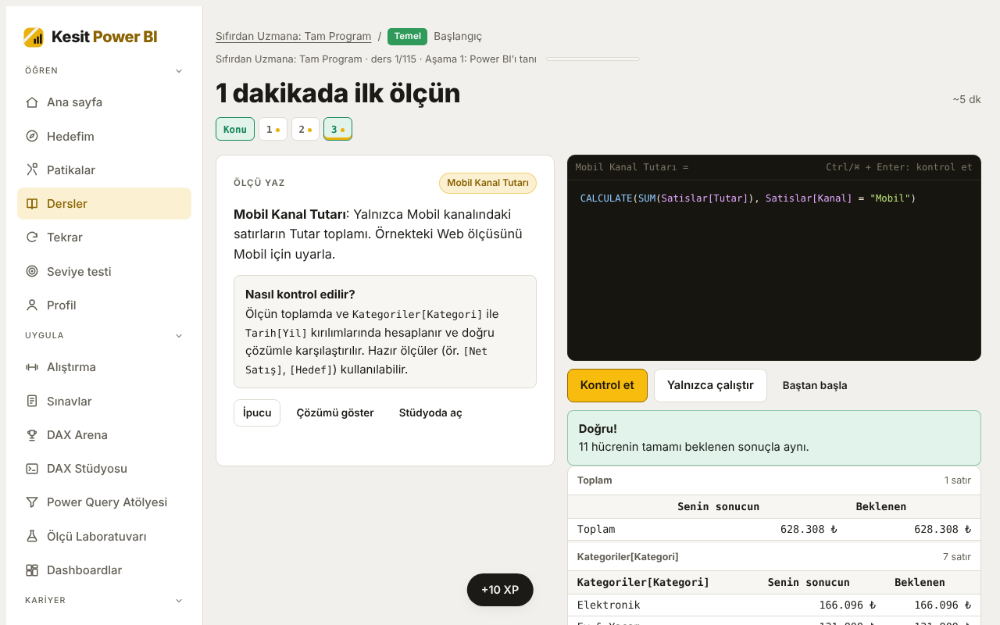
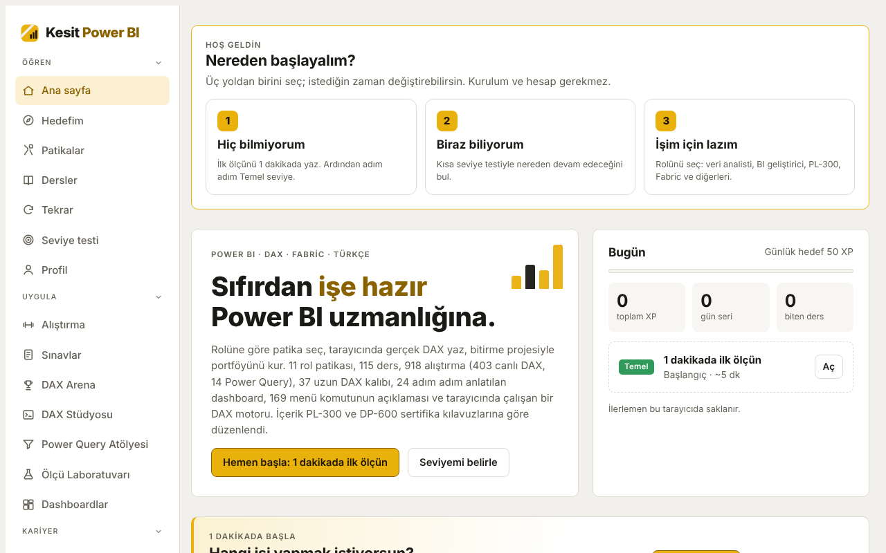
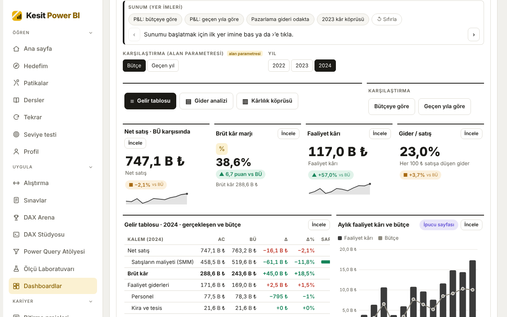
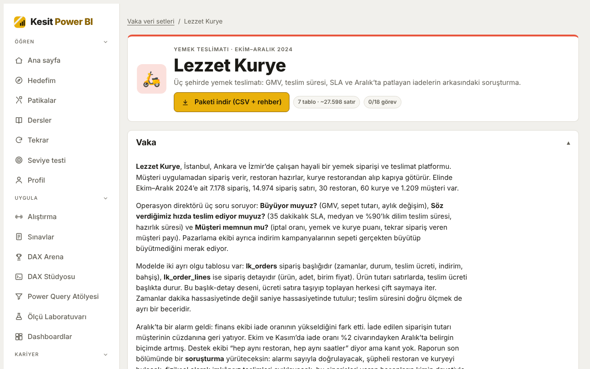

# Kesit Power BI

**Sıfırdan işe hazır seviyeye Türkçe Power BI, DAX ve Fabric eğitimi. Kurulum yok, hesap yok.** Tarayıcında çalışan bir DAX motoruyla ölçü yazarsın; her alıştırma anında denetlenir.

**Dene:** https://ysfdurak.github.io/kesit-powerbi/

## Neler var?
- **115 ders, 918 ders içi alıştırma, 78 pratik görevi.** İlk ölçüden genişletilmiş tablolara, hesaplama gruplarına, Direct Lake'e ve mülakat kalıplarına kadar; Temel, Orta ve İleri seviyeler.
- **11 rol patikası:** veri analisti, BI geliştirici, PL-300, DP-600 / Fabric, DAX ustalığı, Excel'den Power BI'a ve diğerleri. Her patikanın bitirme projesi ve işe hazırlık listesi var.
- **24 örnek rapor, 104 sayfa:** yer imleri, araç ipucu sayfaları, detaya git, alan parametreleri ve mobil düzenle, adım adım anlatılmış.
- **6 hayali veri seti:** Anadolu Market (derslerin modeli) ve Desktop'ta çalışmak için 5 vaka paketi: Ilgaz Bank, Kanat Havayolları, Lezzet Kurye, Pusula A.Ş. İnsan Kaynakları, Pedal İzmir. Her pakette CSV'ler, model planı, ölçü kütüphanesi ve beklenen sonuçlu görevler var.
- **Sınav ve mülakat:** 155 özgün PL-300 / DP-600 deneme sorusu, 164 mülakat sorusu (zayıf ve güçlü cevap örnekleriyle), canlı DAX kodlama turu, ev ödevleri.
- **86 püf noktası, 60 sık karıştırılan kavram**, sık yapılan hatalar, DAX Arena, DAX Stüdyosu ve Power Query atölyesi.

| Karşılama | Örnek rapor | Vaka veri seti |
|---|---|---|
|  |  |  |

## Nasıl çalışıyor?
- Sunucu yok: DAX'ın filtre bağlamı, bağlam geçişi, zaman zekâsı ve tablo fonksiyonları tarayıcıda çalışan bir motorla hesaplanıyor. Power Query adımları da tarayıcıda benzetiliyor.
- İlerleme yalnızca kullanıcının tarayıcısında saklanıyor; Profil sayfasından dosyaya kaydedilip başka cihazda yüklenebiliyor. Kişisel veri toplanmıyor; ziyaretler yalnızca çerezsiz ve anonim olarak sayılıyor (GoatCounter, açıksa).
- Alıştırmalar ve vaka paketlerinin beklenen sonuçları otomatik bir denetim setiyle doğrulanıyor; vaka paketlerinde her sonuç ayrıca SQL ile bağımsız olarak hesaplanıyor.

## Kardeş proje
Aynı mantıkla hazırlanmış SQL eğitimi: **[Kesit SQL](https://ysfdurak.github.io/kesit-sql/)** ([kaynak](https://github.com/ysfdurak/kesit-sql)). Vaka veri setlerinin SQL karşılıkları orada.

## Geri bildirim
Her dersin başlığının altında geri bildirim bağlantısı, konu anlatımının altında yorum alanı var. Genel fikirler için bu deponun **Discussions** sekmesini kullanabilirsin.

## Sorumluluk notu
Ücretsiz, ticari olmayan bir eğitim ve portföy projesidir; içerik “olduğu gibi” sunulur. Veri setlerindeki tüm şirketler, kişiler ve kayıtlar hayalidir. Microsoft ile bağlantılı değildir; Microsoft, Power BI, Fabric ve sınav adları Microsoft Corporation'ın markalarıdır. Sınav denemeleri özgün olarak yazılmıştır, gerçek sınav soruları değildir. Uygulamanın verdiği belgeler kendi beyana dayalıdır.

## Lisans
- Uygulama kodu: [MIT](LICENSE)
- Ders içerikleri, veri setleri ve vaka paketleri: [CC BY-NC 4.0](LICENSE-ICERIK.md)
