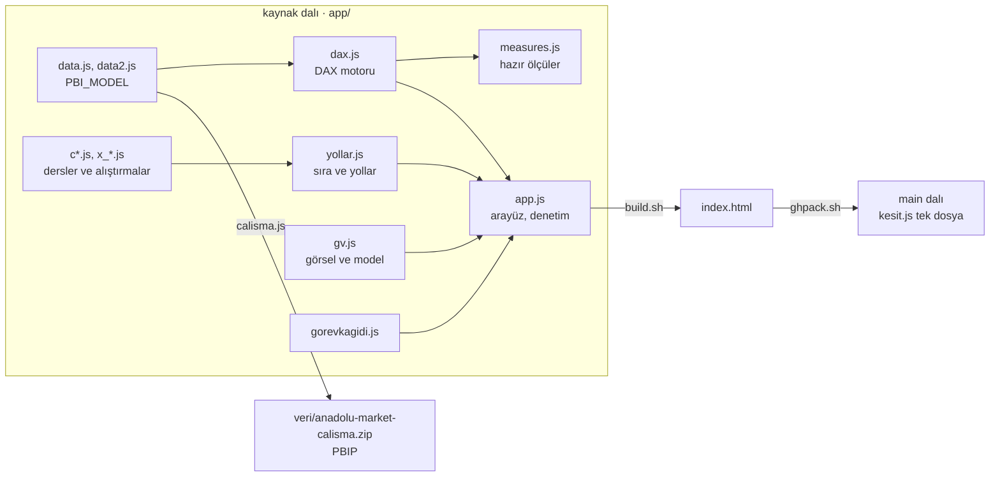

# Kesit Power BI · proje rehberi

Yaşayan hâkimiyet dokümanı. Amaç: kodu Claude yazmış olsa da projeyi açıp anlatabilmen, bir mülakatta kararları savunabilmen. Geliştirme ayrıntısı (komutlar, yollar, doğrulayıcı listesi) `NASIL.md` içindedir; bu doküman "ne, neden, nasıl çalışıyor" sorularına cevap verir. Doğrulanamayan bilgi **[doğrulanacak]** diye işaretlidir.

## 1. Bir bakışta

| | |
|---|---|
| Ne | Tarayıcıda çalışan Türkçe Power BI ve DAX öğrenme uygulaması. Ders, alıştırma, örnek rapor, Power Query Lab, vaka veri setleri, sınav ve mülakat hazırlığı. |
| Kimin için | Power BI'a yeni başlayan analistten PL-300 / DP-600 hazırlığı yapana kadar. Power BI Desktop olmayan (Mac, telefon) öğrenci de dersleri çözebilir. |
| Canlı | https://ysfdurak.github.io/kesit-powerbi/ |
| Depo | `ysfdurak/kesit-powerbi`. `kaynak` dalı = kaynak kod ve testler, `main` dalı = derlenmiş site (elle düzenlenmez). |
| Sayılar (Kasım 2026 sonu) | 158 ders, 1.438 alıştırma (710 çoktan seçmeli, 411 DAX ölçüsü, 142 DAX sorgusu, 50 görsel kurma, 9 model kurma, 78 M kodu, 38 Power Query Lab), DAX motorunda 260 işlev |
| Sunucu | Yok. GitHub Pages'te statik site; ilerleme tarayıcıda (`localStorage`, anahtar `pbipatika.v1`). Kalıcı hesap ya da sınıf takibi istenirse VPS gerekir. |
| Lisans | Kod PolyForm Shield 1.0.0, içerik ve veri CC BY-NC 4.0 |

## 2. Sorun ve kararlar

**Sorun:** Power BI öğrenmek için Windows ve Desktop gerekir; Türkçe kaynaklar video ağırlıklıdır ve öğrencinin yazdığı ölçünün doğru olup olmadığını kimse denetlemez.

**Senin kararların:**
- Desktop'u taklit etmek yerine **DAX'ı tarayıcıda hesaplayan bir motor** yazmak. Öğrenci ölçüyü yazar, motor bir tablo görselindeki gibi her satırda hesaplar, doğru çözümle hücre hücre karşılaştırır.
- Tek bir hayali şirket (**Anadolu Market**) üzerinde bütün dersler; Kesit SQL ile aynı siparişler. Vaka paketleri (Ilgaz Bank, Kanat Havayolları, Lezzet Kurye, Pusula İK, Pedal İzmir) ayrı.
- Motorun bilmediği her şeyi açıkça söylemek (`data-notry`, `bilinen-sinirlar.js`, NASIL.md › Bilinen motor sınırları) ve Desktop'la 6 tur karşılaştırma yapmak.
- Kasım 2026: Kesit Power BI'ı Kesit Excel'in uygulamalı düzeyine çıkarmak (bkz. 13).

## 3. Mimari ve veri akışı

- **Model:** `PBI_MODEL.tables` (satır nesneleri, sütun listesi, `kind` dim/fact/param, `sortBy`, `dateTable`) ve `rels` (`from/fromCol → to/toCol`, `inactive`, `both`).
- **Motor:** `X.query({rows, measures, values, slicers, totals})` bir tablo görselinin hücrelerini, `X.runQuery` bir `EVALUATE` sorgusunu, `X.evalMeasure` tek değeri hesaplar. Filtre bağlamı satır satır kurulur; ilişkiler yön ve etkinlik kurallarıyla yayılır.
- **Alıştırma denetimi:** çözüm ve öğrenci ölçüsü aynı ızgarada (varsayılan `Kategoriler[Kategori] × Tarih[Yil]`, toplam satırıyla) hesaplanır; gizli dilimleyici testleri sabit sonuç yazan ölçüleri yakalar.

## 4. Teknoloji seçimleri

| Seçim | Neden | Elenen alternatif |
|---|---|---|
| Saf JavaScript, derleyicisiz | Paket tek dosya, sunucu yok, claude.ai önizlemesinde de çalışır | React/Vite: bu ölçekte fayda getirmeden derleme zinciri ekler |
| Kendi DAX motoru | Öğrencinin yazdığı DAX'ı çalıştırmak için başka yol yok (Analysis Services tarayıcıda çalışmaz) | Ezber cevap karşılaştırma: farklı ama doğru çözümü reddeder |
| PBIP + gömülü CSV (çalışma paketi) | Dosya yolu ve ağ geçidi gerekmez; Desktop'ta açıp yenilemek yeter; metin dosyası olduğu için üretilebilir ve git'te okunur | .pbix: ikili ve belgelenmemiş biçim, kodla üretilemez |
| Görev kâğıdı tarayıcıda üretilir | Beklenen sonuçlar her zaman motorla aynı; 158 ayrı dosya depolamaya gerek yok | Önceden üretilmiş dosyalar: içerik değişince eskir |

## 5. Kod turu

- `app/dax.js` — Sözdizimi çözümleyici, `ARITY` tablosu (her işlevin bağımsız değişken sayısı), `FN.ADI = (eng, args, st) => …` biçiminde işlevler. Yardımcılar: `evS` (sayıl), `evT` (tablo), `iterate` (satır bağlamı), `visible` (filtre bağlamında görünen satırlar). Yeni işlev eklemek = ARITY'ye satır + FN'e fonksiyon + `extra.js` kataloğuna örnek.
- `app/gv.js` — Görsel kurma (`gorselView`, `gorselDenetle`) ve model kurma (`modelView`, `modelDenetle`). Görsel verisi `X.query` ile gelir, çizim `viz.js`'teki `PBIViz` ile. Model alıştırmasında öğrencinin ilişkileriyle `PBI_CREATE_DAX` yalıtılmış bir motor kurar ve önizleme tablosu gösterir: ilişki ters kurulursa sayılar gerçekten bozulur.
- `app/c29.js`, `app/x_gorsel.js`, `app/x_ek.js` — Bu turun içerikleri. Yeni ders `add(after, ders)`, var olan derse alıştırma `ext(id, ex)`.
- `app/gorevkagidi.js` — `kagit(ders)` Markdown üretir: her DAX görevinin beklenen tablosu (ızgaranın her sütunu ayrı), görsel görevin kategori/değer tablosu, model görevinin ilişki listesi; çözümler en sonda.
- `app/build/calisma.js` — Node'da modeli yükler, her tabloyu CSV'ye çevirir, deflate + base64 ile M ifadesine gömer, `model.bim` (compatibilityLevel 1600, tr-TR), boş bir PBIR raporu, `DOGRULAMA.md` (motorun kontrol değerleri) yazar ve zip'ler. Ölçüler yalnız paketteki tablolara dayananlardan ve motorda hatasız çalışanlardan seçilir.

## 6. Sunucu ve yayın

Sunucu yok. `kaynak` dalında `sh app/build/ghpack.sh` → `scratchpad/gh/kesit-powerbi/` → içerik `main` dalına PR ile gelir → GitHub Pages yayınlar. Ortak altyapı (Cloudflare, alan adı) için `ysfdurak.com` › `docs/NASIL-CALISIR.md`.

## 7. Testler

Node doğrulayıcıları `tests/` (NASIL.md › Testler). Bu turun örneklem testi:

| Adım | Beklenen | Gözlenen | Durum |
|---|---|---|---|
| lessonval, hiddenval, exval, extval, mval, argval, dashval, codeval, yolval, termval | SORUN 0 | SORUN 0 (hiddenval: 404 DAX + 109 sorgu) | ✓ |
| gvval (görsel/model) | Çözümler kabul, 46 bozulmuş çözüm reddedilir | 46 alıştırma, 9 görsel hesaplama vakası, SORUN 0 | ✓ |
| audit | Yeni uyarı yok | Önceki dalla birebir aynı 144 satır | ✓ |
| Tarayıcı 1350 ve 390 px: görsel ve model alıştırması çöz | "Doğru!", konsol hatası yok | Tuttu | ✓ |
| 158 dersin görev kâğıdı üretimi | Hesaplanamayan görev yok | İlk denemede 2 (tek satırlı hücrede CONFIDENCE.T/NORM.INV hatası); alıştırma düzeltildi, sonra 0 | ✓ |
| Çalışma paketi Desktop'ta açılır, kontrol değerleri tutar | 15 değer birebir | Yapılmadı | **[doğrulanacak]** (G40) |

> **Burada bir test daha yapalım:** Yeni 53 DAX işlevi Excel'in bilinen sonuçlarıyla denetlendi ama Power BI Desktop'la karşılaştırılmadı. G40 turunda en az PPMT, NPER, LINESTX, CONFIDENCE.T, OPENINGBALANCEMONTH ve INFO.VIEW.MEASURES denenmeli.

## 8. Bilinen sınırlar ve sonraki adımlar

- Görsel hesaplama dili alt kümedir (reset/axis yok); INFO.VIEW yalnız temel sütunlar; EVALUATEANDLOG günlük yazmaz.
- Görsel alıştırması grafik biçimlendirmesini (renk, başlık, eksen) denetlemez; yalnız görselin taşıdığı veriyi denetler.
- 17 derste 3'ten az uygulamalı görev kaldı: tarayıcıda gerçeği yapılamayan Service konuları (çalışma alanı, paylaşım, yorum, kullanım izleme) ve iki görevli Fabric dersleri. Bunlara arayüz taklidi eklenmedi.
- Çalışma paketinde ham tablolar yok; Power Query temizliği için vaka paketleri kullanılır.
- **Şöyle daha iyi olur:** görev kâğıdı .md yerine doğrudan PBIP içine bir "Görevler" sayfası (metin kutularıyla) olarak da gömülebilir; Desktop'ta tek dosyadan çalışılır. Önce G40 doğrulaması.

## 9. Mülakat soruları

1. **Neden kendi DAX motorunu yazdın?** Öğrencinin yazdığı ölçüyü çalıştırıp denetlemenin tarayıcıda başka yolu yok. Analysis Services motoru tarayıcıda çalışmaz; ezber cevap karşılaştırması doğru ama farklı yazılmış çözümü reddeder.
2. **Motorun doğru hesapladığını nasıl biliyorsun?** Altı tur Desktop karşılaştırması (1.112 ölçü + 237 sorgu, 187 vaka ölçüsü, 207 M sorgusu); bağımsız hesapla çapraz denetim (`cross.js`); vaka paketlerinde aynı soru SQLite'ta da çalıştırılır.
3. **Görsel kurma alıştırması neyi denetliyor?** Görsel türünü (kabul edilen türler listesi), kategori kümesini ve sırasını, her serinin değerlerini. Ayarları değil sonucu denetler: İlk 3'ü görsel filtresiyle de, sıralayıp el ile de bulsan aynı veri çıkarsa kabul.
4. **Model alıştırmasında ilişki ters kurulursa ne olur?** Yalıtılmış motor öğrencinin ilişkileriyle kurulur; önizleme tablosunda her satıra aynı toplam yazılır. Geri bildirim "ilişki ters: bir taraf boyut tablosu olmalı" der.
5. **PBIP'yi neden seçtin, .pbix değil?** PBIP metin tabanlı ve belgeli (model.bim/TMSL, PBIR); kodla üretilebilir, git'te farkı okunur. .pbix ikili.
6. **Veri neden M ifadesine gömülü?** Dosya yolu değişince kırılan bağlantı ve izin sorunları olmasın; paket her bilgisayarda "aç ve yenile" ile çalışsın.
7. **Görsel hesaplama ile ölçü arasındaki fark nedir?** Görsel hesaplama görselin kendi sonuç tablosu üzerinde çalışır (RUNNINGSUM, PREVIOUS); modelde ölçü olarak yaşamaz, başka görselde kullanılamaz. Ölçü filtre bağlamıyla modelden hesaplanır.

## 10. Kendini test et

Çalışma paketindeki ölçüler hangi kurala göre seçiliyor?
Yalnız paketteki 10 tabloya başvuranlar, bağımlı olduğu ölçüler de pakette olanlar ve motorda hatasız çalışanlar (80 ölçü).

Görev kâğıdındaki beklenen değerler nereden geliyor?
Tarayıcıda, aynı DAX motoruyla ve alıştırmanın ızgarasıyla o an hesaplanıyor. İçerik değişince kâğıt kendiliğinden güncel kalır.

Yeni bir ders eklediğinde yollar testi neden düşebilir?
`yollar.js` aşamaları `slice(başlangıç, bitiş)` ile sıradan dilim alır. Ders bitiş dersinden sonra eklenirse hiçbir aşamaya girmez; bu turda katki-analizi ve secime-gore böyle düştü, bitiş `secime-gore` yapıldı.

CONFIDENCE.T alıştırması neden IF ile sarıldı?
Tek satırlı bir kategoride örneklem 1 olur ve işlev hata verir; Desktop da hata verir. Görsel hücresinde hata görmemek için `IF(COUNTROWS(Satislar) >= 2, …)`.

## 11. Elle yapılacak alıştırma

**Kod değişikliği (15 dk):** `app/x_gorsel.js` içinde `gorsel-temel` dersine yeni bir görsel alıştırması ekle: Kanal başına net satış payını gösteren halka grafiği. Kalıp dosyadaki diğerleriyle aynı: `G('soru metni', { tur: 'halka', eksen: 'Satislar[Kanal]', degerler: ['Net Satış'] }, { kural: { turler: ['halka'] } })`. Sonra `sh app/build/build.sh` ve `node tests/gvval.js`; tarayıcıda dersi açıp çöz.

**5 dakikalık demo akışı:**
1. Ana sayfa → bir DAX dersi → alıştırma: yanlış bir ölçü yaz, hangi hücrenin farklı olduğunu göster (30 sn).
2. "Görsel kurma": İlk 3 temsilci; sıralamayı yanlış seçince geri bildirim (1 dk).
3. "Model kurma": ilişkiyi ters kur, önizlemede bütün satırların aynı değeri gösterdiğini göster (1 dk).
4. Ders sayfasında "Desktop'ta çalış": görev kâğıdını aç, beklenen tabloları göster (1 dk).
5. Mimari: motor + model + denetim; Desktop karşılaştırma turları (1,5 dk).

## 12. Değişiklik günlüğü

| Tarih | Değişiklik |
|---|---|
| 2026-11-08 | Dört etap planı (KALAN-GOREVLER.md), yayın bütünlüğü ve release-manifest |
| 2026-11-22 | Lezzet Kurye PBIP referans paketi Desktop'ta doğrulandı (G04); 6. tur Desktop karşılaştırması |
| 2026-11-27 | Kesit ailesine Kesit Excel bağlantısı |
| 2026-11-27 | Kalan işler turu (14. bölüm): statik ders sayfaları üreteci, kullanıcı gözüyle inceleme, ertelenmiş paket (kesit-ek.js), 41 derse 57 uygulamalı görev. 1.381 → 1.438 alıştırma |
| 2026-11-27 | Excel düzeyine çıkarma turu (aşağıda): görsel ve model kurma, 8 uygulamalı DAX dersi, 53 yeni DAX işlevi, Desktop çalışma paketi ve görev kâğıtları. 150 → 158 ders, 1.250 → 1.381 alıştırma, 207 → 260 işlev |

## 13. Kesit Excel düzeyine çıkarma turu (Kasım 2026)

**Neden:** Kesit Excel'de öğrenci hücreye formül, pivot ve grafik kurarak öğreniyordu; Kesit Power BI'da görsel ve model konuları çoğunlukla çoktan seçmeliydi (66 derste 3'ten az uygulamalı görev). Power BI'da asıl iş görsel ve model kurmaktır.

**Dört aşama (kullanıcı dördünü de seçti):**
1. **Yeni alıştırma türleri** — `gorsel` (38) ve `model` (8). Görsel hesaplama mini dili (9 işlev) dahil.
2. **Uygulamalı DAX dersleri** — `c29.js`: sayma, koşul, CALCULATE pratiği, genel toplam, ilişki işlevleri, zaman pratiği, katkı analizi, seçime göre ölçü (51 DAX + 8 çoktan seçmeli); başlangıç derslerine de görsel alıştırmaları.
3. **DAX motoru ve artımlı yenileme** — 53 işlev (PPMT, IPMT, NPER, RATE, CUMIPMT, NORM.*/T.* dağılımları, CONFIDENCE.*, LINESTX, OPENINGBALANCE*, INFO.VIEW alt kümesi, TOCSV/TOJSON, EVALUATEANDLOG…); `buyuk-model` ve `veri-yenileme` derslerine RangeStart/RangeEnd M alıştırmaları; model ilişkilerinde çift yön (`both`).
4. **Desktop çalışma paketi** — `anadolu-market-calisma.zip` (PBIP) ve her dersin görev kâğıdı.

**Karar ve sonucu:**
- Görsel denetimi ayarları değil veriyi karşılaştırır → farklı ama geçerli kurulumlar kabul edilir; ama biçimlendirme denetlenmez (sınır).
- 6 temsilcili modelde "İlk 10" anlamsız → "İlk 3". Alan uzmanı gözü: alıştırma verisi gerçek bir karar sorusuna benzemeli.
- Net Satış zaten Durum filtresini ezdiği için Durum dilimleyicili görsel yanıltıcıydı → Kanal = Web filtresine geçildi.
- Telefonda eksen etiketleri kesiliyordu → `viz.js`'e `padL` seçeneği, görsel genişliği 460.
- Açılış paketi bütçeyi aştı (5,11 MB ham, 1,57 MB gzip). Geçici olarak sınır yükseltildi, sonra 14. bölümdeki ertelenmiş paketle eski sınırın altına inildi.

## 14. Kalan işler turu (Kasım 2026)

Kullanıcı "hepsini sırayla yap" dedi; dört iş bu sırayla yapıldı.

### 14.1 Statik ders sayfaları (`app/build/statik.js`)
`main` dalındaki `ders/<id>/index.html` sayfaları (arama motoru ve JavaScript'siz okuyucu için dersin okuma sürümü) bir zamanlar elle üretilmişti ve üreteci depoda yoktu; yeni dersler sayfasız kalıyordu. Üreteç yeniden yazıldı ve `ghpack.sh` her derlemede çalıştırıyor.
- **Nasıl doğrulandı:** 150 eski sayfayla karşılaştırıldı. Başlık, açıklama kısaltması (155 karakterde kelime sınırı + "…"), JSON-LD ve gövde birebir; fark yalnız güncel alıştırma sayısı, ders sırası (artık öğrenme yoluyla aynı: seviye → modül → sıra) ve sonradan değişen içerik.
- Uygulama içi düğmeler (`button.lnk data-lesson/data-go/data-act`) statik sayfada bağlantıya çevrilir.
- `sitemap.xml` ve `ders/statik.css` artık kaynak dalında; site haritasındaki ders adresleri her derlemede yeniden yazılır.

### 14.2 Kullanıcı gözüyle inceleme (görsel ve model kurma)
| Rol | Bulgu | Karar |
|---|---|---|
| Öğrenci (ilk kez) | Görsel türü "Kümelenmiş sütun" seçili geliyordu: sorunun cevabını veriyordu | Boş gelir; ilk uyarı "Görsel türü seç" |
| Tasarımcı | Telefonda form alanları panel kenarına yapışık | Panele iç boşluk |
| Öğretmen / alan uzmanı | Model önizlemesinde her satır aynı toplam ama nedeni yazmıyor | "Her satırda aynı değer: filtre ölçünün tablosuna ulaşmıyor (ilişki yok, ters ya da pasif)" açıklaması |

Ders: bunları teknik testler değil, görevle gezinti buldu (gvval ve tarayıcı testleri yeşildi).

### 14.3 Ertelenmiş paket (`kesit-ek.js`)
**Neden yarım değil:** Ders gövdeleri birçok dosyada ekleniyor (`l.body +=`), bu yüzden "dersleri açılınca yükle" ancak içerik mimarisi değişirse mümkün (seviye seviye içerik dosyası). Onun yerine bağımsız bölümler ayrıldı: sık karıştırılanlar, sık hatalar ve mülakat (`confused*.js`, `interview*.js`, `guides.js`).
- `ghpack.sh` bu beş dosyayı `kesit-ek.js`'e koyar; `kesit.js` başındaki yükleyici sayfa yüklendikten sonra onu çeker (`window.PBI_EK` sözü).
- Bu bölümlere doğrudan adresle (`#hatalar`, `#kariyer`) ya da menüden gelinirse "Bölüm yükleniyor…" görünür, yüklenince sayfa açılır; yüklenemezse "bağlantını kontrol et" uyarısı.
- `inventory.js` sayımları getter'a çevrildi: sonradan gelen içerik de sayılır.
- Sonuç: `kesit.js` 5,11 → 4,60 MB (gzip 1,57 → 1,41 MB); bütçe eski 5,1 / 1,56 MB değerine döndü.
- **Şöyle daha iyi olur:** örnek raporlar (`dash_*.js`, ~650 KB) da ertelenebilir ama `pages.js` açılışta rapor haritası (DMAP) kuruyor ve bitirme projesi sayfası onlara bağlı; önce o haritayı tembel yapmak gerekir.
- **Burada bir test daha yapalım:** Gerçek Android telefonda yavaş bağlantıda (3G) `#kariyer` adresini doğrudan aç; bekleme ekranı birkaç saniyeden uzun sürmemeli.

### 14.4 Az uygulamalı derslere görev (`app/x_uygulama.js`)
46 dersin 41'ine 57 görev. İlke: arayüz taklidi yok; her görev tarayıcıda gerçekten yapılan ve denetlenen bir iş:
- Service ve yönetim dersleri: yayın öncesi mutabakat, model envanteri (INFO.VIEW), `DEFINE MEASURE` ile yerel deneme, REST `executeQueries` sorgusu.
- Fabric: yük sonrası mutabakat, artımlı yük filigranı, gümüş katman kalite kuralı, PySpark/T-SQL sonucunu anlam modelinde doğrulama, gider tablolarını yıldız şemaya bağlama.
- Kariyer: Projeler (geciken proje, bütçe kullanımı) ve Talepler (ilk yanıt süresi) üzerinde ölçü.
- İlk taslakta sonucu 0 ya da boş çıkan üç görev (eşleşmeyen satır, tekrar eden anahtar, tekrar eden olay) değiştirildi: sabit cevabı tahmin edilebilen görev öğretmez. Teslim tarihi kuralında boş tarihin karşılaştırmada en küçük sayılması tuzağı görev metnine yazıldı.

